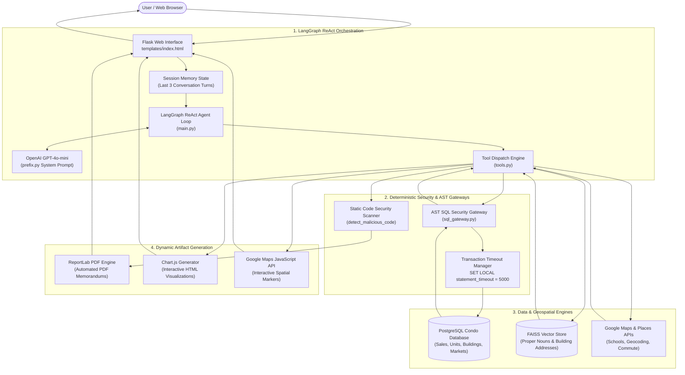
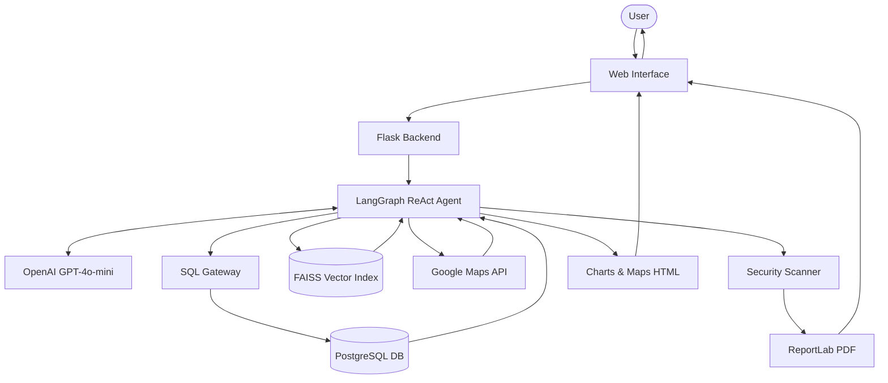

<div align="center">


# Miami Condo GPT

> **An agentic real estate intelligence assistant powered by LangGraph, PostgreSQL, and geospatial analytics.**

[](requirements.txt)
[](main.py)
[](sample_db.sql)
[](main.py)
[](tools.py)
[-success.svg)](tests/)
[](LICENSE)

</div>

---

**Miami Condo GPT** empowers real estate brokers, analysts, and institutional investors to interrogate high-end Miami residential transaction data using natural language. Operating over historical transaction records from [Condo Cube](https://condo-cube.com/) across South Beach, Miami Beach, and South of Fifth, the assistant translates plain-English questions into AST-validated SQL queries, retrieves proper nouns through vector search, queries live Google geospatial APIs for school commutes, and generates interactive Chart.js visualizations or sandboxed ReportLab PDF investment memorandums.

**21 automated unit and security tests gate every push at zero API cost** — covering the SQL AST security gateway, transaction timeouts, proper noun embeddings, and dynamic code sandbox scanners without external database or OpenAI API dependencies during CI.

---

## AI Engineering Architecture

The architecture separates natural language planning, deterministic query sanitization, geospatial proximity calculations, and dynamic artifact rendering across five synchronized layers:



---

## Core AI Engineering Patterns

### 1. AST-Enforced SQL Security Gateway ([`sql_gateway.py`](sql_gateway.py))
- **AST Parsing with `sqlparse`**: Rejects all query strings containing multiple statements (semicolon-chaining prevention) and enforces that only `SELECT` or `WITH ... SELECT` queries are executed.
- **Strict Blacklists**: Detects and blocks DML (`INSERT`, `UPDATE`, `DELETE`), DDL (`DROP`, `ALTER`, `TRUNCATE`), administrative privileges (`GRANT`, `REVOKE`), and PostgreSQL system exploits (`PG_SLEEP`, `DBLINK`, `PG_READ_FILE`, `LO_IMPORT`).
- **Row Limit Capping**: Automatically injects or caps `LIMIT` to prevent out-of-memory errors (default 100, maximum 1000).
- **Transaction-Level Statement Timeouts**: Executes queries inside an isolated transaction with `SET LOCAL statement_timeout = 5000` to prevent runaway analytical queries or Denial of Service.

### 2. Hybrid Vector & Proper Noun Entity Resolution ([`tools.py`](tools.py))
- **The Challenge**: Users frequently supply colloquial or misspelled building names (e.g., *"Continuum"*, *"Apogee"*, *"1 Hotel"*) or non-standard address formats (*"Collins Ave"* vs *"Collins Avenue"*).
- **Vector Retriever**: Pre-indexes all unique building addresses and alternative names from `core_condobuilding` into an in-memory `FAISS` vector store with `OpenAIEmbeddings`.
- **Preflight Entity Resolution**: The agent calls `search_proper_nouns` prior to formulating SQL queries, mapping arbitrary user input to canonical database keys.

### 3. Sandboxed Dynamic Code & PDF Execution ([`main.py`](main.py))
- **ReportLab PDF Generation**: Generates automated, publication-ready PDF reports on-the-fly for real estate presentations.
- **Preflight Static AST & Regex Scanner**: Analyzes all dynamic Python code against forbidden OS, process, socket, and reflection patterns (`os.system`, `subprocess`, `eval`, `shutil`, `socket`, `importlib`) before compiling or executing.
- **Sanitized HTML Blocks**: Automatically extracts and sanitizes inline Chart.js JavaScript and Google Maps marker scripts, stripping duplicate tags and preventing injection vulnerabilities.

### 4. Domain Analytical Modeling & Holding Periods ([`prefix.py`](prefix.py), [`boilerplate.py`](boilerplate.py))
- **Holding Period Analysis**: Synthesizes PostgreSQL queries utilizing `LAG()` window functions across sales to trace unit resale cycles, computing historical hold times and annualized returns.
- **Geospatial Cross-Referencing**: Pairs SQL building coordinates with Google Places to discover nearby educational institutions, and computes driving distance and commute times using the Google Directions API.

---

## Shipped Tools & APIs

| Tool Name | Engine | Input Schema | Purpose |
| :--- | :--- | :--- | :--- |
| `sql_db_query` | Safe SQL Gateway | `{"query": "SELECT ..."}` | Validates query against AST security rules and executes read-only SQL with 5s timeout. |
| `search_proper_nouns` | FAISS Vector Store | `{"query": "string"}` | Fuzzy searches building names and street addresses across embedded proper nouns. |
| `google_maps_geocoding` | Google Geocoding API | `{"address": "string"}` | Converts street addresses or landmarks into geographic coordinates (`lat`, `lng`). |
| `google_maps_directions` | Google Routes API | `{"origin": "...", "destination": "..."}` | Computes driving distance and commute duration by car between two addresses/coordinates. |
| `google_places` | Google Places API | `{"query": "string"}` | Searches for nearby points of interest (schools, parks, transit) within a 5,000m radius. |
| `sql_db_schema` | LangChain SQL Toolkit | `{"table_names": "string"}` | Returns column names, data types, and sample rows for requested database tables. |
| `sql_db_list_tables` | LangChain SQL Toolkit | `{}` | Lists all accessible tables within the active PostgreSQL database. |

---

## Interactive User Journeys

Condo GPT maintains multi-turn session memory (last 3 interactions), enabling progressive conversational drill-downs:

```
User: "What buildings on Collins Ave had the most sales in 2023?"
Agent: [Executes AST-validated SQL across core_condosale and core_condobuilding]
       Returns top 5 buildings: 1500 Ocean Drive, 1000 Collins, etc.

User: "Generate a chart of this data."
Agent: [Generates dynamic Chart.js canvas with building labels and sales volume]
       Renders interactive bar chart directly inside the browser console.

User: "Put the data in an HTML table with sales volume and median price."
Agent: [Aggregates SUM(sale_price) and PERCENTILE_CONT(0.5)]
       Returns formatted HTML comparison table.

User: "Add a column showing the closest elementary school to each building and driving commute time."
Agent: [Calls google_places for elementary schools + google_maps_directions for travel time]
       Enriches table with school names, distances in miles, and car transit minutes.

User: "Generate a PDF investment memorandum of this analysis."
Agent: [Produces ReportLab Python script -> Passes AST security scanner -> Compiles PDF]
       Saves PDF report to project directory and displays download confirmation in UI.
```

---

## Quickstart

### Prerequisites
- Python 3.11+
- PostgreSQL 14+
- OpenAI API Key
- Google Maps API Key (with Places, Geocoding, and Directions APIs enabled)

---

### Windows (PowerShell)

```powershell
# 1. Clone and navigate to repository
git clone https://github.com/VJGit1/Miami-Condo-GPT.git
cd Miami-Condo-GPT

# 2. Create and activate virtual environment
py -3.11 -m venv venv
.\venv\Scripts\Activate.ps1

# 3. Install dependencies
pip install -r requirements.txt

# 4. Configure environment variables
Copy-Item .env.example .env
# Edit .env with your credentials
```

### macOS / Linux (Bash)

```bash
# 1. Clone and navigate to repository
git clone https://github.com/VJGit1/Miami-Condo-GPT.git
cd Miami-Condo-GPT

# 2. Create and activate virtual environment
python3.11 -m venv venv
source venv/bin/activate

# 3. Install dependencies
pip install -r requirements.txt

# 4. Configure environment variables
cp .env.example .env
# Edit .env with your credentials
```

---

### Database Setup

Create the database and read-only user, then import the sample dataset (covers Miami Beach, South Beach, and South of Fifth):

```bash
psql -U postgres
```

```sql
CREATE DATABASE condo_gpt;
CREATE USER readonly_user WITH PASSWORD 'your_password';
GRANT CONNECT ON DATABASE condo_gpt TO readonly_user;
\c condo_gpt
GRANT USAGE ON SCHEMA public TO readonly_user;
GRANT SELECT ON ALL TABLES IN SCHEMA public TO readonly_user;
ALTER DEFAULT PRIVILEGES IN SCHEMA public GRANT SELECT ON TABLES TO readonly_user;
\q
```

Import sample transactions and building folios:

```bash
psql -U postgres -d condo_gpt -f sample_db.sql
```

---

### Environment Variables

Configure `.env` in the root directory:

| Variable | Description | Example |
| :--- | :--- | :--- |
| `OPENAI_API_KEY` | OpenAI platform API key for GPT-4o-mini & embeddings | `sk-proj-...` |
| `GPLACES_API_KEY` | Google Maps API key (Places, Geocoding, Directions) | `AIzaSy...` |
| `FLASK_SECRET` | Secret key for Flask session cookie encryption | `your-secret-key-32-chars` |
| `PG_USER` | PostgreSQL read-only database username | `readonly_user` |
| `PG_PASSWORD` | PostgreSQL database password | `your_password` |
| `PG_PORT` | PostgreSQL port | `5432` |
| `PG_DB` | PostgreSQL database name | `condo_gpt` |

---

## Example Prompt Sequence

- What buildings on collins had the most sales in 2023?
- Generate a graph of this data
- Put the data in an html table
- Add a third column with the total sales volume of each building
- Add a fourth column with the median sales price for each building
- Replace the third column with the closest school to the building, and the fourth column with the driving distance to that school from the building

## Architecture



## Project Structure

- `server.py` — Flask web server and session memory
- `main.py` — LangGraph ReAct agent orchestration and stream processing
- `tools.py` — The active agent tools (Safe SQL, FAISS, Places, Geocoding, Directions)
- `sql_gateway.py` — AST-based SQL security gateway and statement timeout manager
- `prefix.py` — System prompt and domain rules
- `boilerplate.py` — Few-shot SQL holding period templates
- `tests/` — Automated test suite covering SQL Gateway, tool schemas, and security sandbox
- `sample_db.sql` — PostgreSQL sample dataset

### Launch Application

```powershell
# Windows PowerShell
.\venv\Scripts\python.exe server.py

# macOS / Linux
python server.py
```

Open [http://localhost:5000](http://localhost:5000) in your web browser.

---

## Testing & Security Verification

The automated test suite runs with zero token cost and requires no active database or API keys. It verifies AST security filters, SQL gateway timeouts, proper noun tool schemas, and malicious code detection:

```powershell
# Run full test suite with verbose output
.\venv\Scripts\python.exe -m unittest discover -s tests -v
```

### Test Suite Coverage (21 Automated Tests)

| Test Module | Target Component | Verifications |
| :--- | :--- | :--- |
| `tests/test_sql_gateway.py` | `sql_gateway.py` | Valid `SELECT` & CTE parsing, DML rejection (`INSERT`/`UPDATE`/`DELETE`), DDL rejection (`DROP`/`ALTER`/`TRUNCATE`), semicolon-chaining blocking, `LIMIT` capping, forbidden function blocking (`PG_SLEEP`, `DBLINK`), timeout enforcement. |
| `tests/test_code_sandbox.py` | `main.py` | Preflight security detection of `os.system`, `subprocess`, `shutil`, `socket`, `eval`; extraction and sanitization of dynamic HTML Chart.js and ReportLab blocks. |
| `tests/test_tools.py` | `tools.py` | Schema validation for `sql_db_query`, `google_maps_geocoding`, and `google_maps_directions`; execution blocking on destructive tool calls. |

---

## Repository Layout

```
Miami-Condo-GPT/
├── .env.example          # Environment template with required credentials
├── .gitignore            # Git exclusion rules (venv, .env, __pycache__)
├── LICENSE               # MIT License
├── README.md             # Project documentation & architecture guide
├── requirements.txt      # Pinned dependencies (Flask, LangGraph, ReportLab, FAISS)
│
├── server.py             # Flask application entrypoint & session memory manager
├── main.py               # LangGraph ReAct agent orchestration & code sandbox scanner
├── tools.py              # Agent tool implementations (Safe SQL, FAISS, Google APIs)
├── sql_gateway.py        # AST SQL validator, keyword blacklist & transaction timeouts
├── prefix.py             # ReAct system prompt, table definitions & domain few-shots
├── boilerplate.py        # Few-shot templates for holding periods & map initializers
│
├── sample_db.sql         # 10MB PostgreSQL dataset (Miami Beach & South Beach sales)
├── static/
│   └── images/
│       └── logo.webp     # Project logo
├── templates/
│   └── index.html        # ChatGPT-styled conversational interface
│
└── tests/
    ├── test_sql_gateway.py   # SQL AST parser and query isolation tests
    ├── test_code_sandbox.py  # Code security scanner and artifact extraction tests
    └── test_tools.py         # Tool schema and query blocking tests
```

---

## Repository Tags & GitHub Topics

To help researchers, developers, and investors discover this repository on GitHub:

### Recommended GitHub Topics (Tags)
Add these topics under **About** $\rightarrow$ **Edit repository details** $\rightarrow$ **Topics** on GitHub:

```
langgraph, react-agent, postgresql, llm, real-estate, openai, gpt-4o-mini, geospatial, faiss, vector-search, reportlab, flask, chartjs, google-maps-api, sql-security
```

### Git Release Tags
This repository uses Semantic Versioning for releases. Create and push the initial version tag:

```bash
git tag -a v1.0.0 -m "Release v1.0.0: Initial release of Miami Condo GPT with LangGraph ReAct agent, AST SQL Gateway, and geospatial tools"
git push origin v1.0.0
```

---

## License

This project is licensed under the MIT License — see the [LICENSE](LICENSE) file for details.
